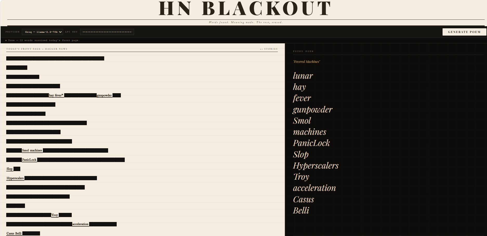

# HN Blackout

**Blackout poetry from the Hacker News front page.**

*Words found. Meaning made. The rest, erased.*



Inspired by [Austin Kleon's blackout poetry](https://austinkleon.com/category/newspaper-blackout-poems/), this tool fetches today's Hacker News headlines and asks an LLM to pick 10–15 words that form a haunting found poem. Everything else gets blacked out — marker-stroke animation and all.

---

## What it does

1. Pulls the top 20 stories from the HN Firebase API
2. Sends the headlines to Cloudflare Workers AI (`llama-3.3-70b`, with a Mistral fallback)
3. The LLM selects words that form an evocative poem when read in sequence
4. The page animates: non-selected words are blacked out one by one
5. The surviving words appear as a found poem on the right panel

Each run produces a different poem — the headlines change daily, and the LLM makes different choices each time.

## Running

The poem comes from a Cloudflare Pages Function, so run it with Wrangler (the AI binding calls Workers AI on your account):

```bash
wrangler pages dev .
# then open http://localhost:8788/
```

No API key needed in the browser.

## Deploying

```bash
wrangler pages deploy . --project-name hn-blackout --branch main
```

## Example output

From a real run on April 18, 2026:

**"Fevered Machines"**

> lunar  
> hay  
> fever  
> gunpowder  
> Smol  
> machines  
> PanicLock  
> Slop  
> Hyperscalers  
> Troy  
> acceleration  
> Casus  
> Belli

The original HN headlines — "hay fever" and "gunpowder" from a history piece, "Smol machines" from an AI post, "PanicLock" and "Hyperscalers" from security and infra stories, "Casus Belli" from geopolitics — were blacked out except for these fragments.

## Architecture

`blackout.html` holds the UI and runs in the browser. One Pages Function, `functions/api/poem.js`, does the LLM call. No build step.

- HN data: [Firebase HN API](https://hacker-news.firebaseio.com/v0/) — public, no key needed
- `POST /api/poem`: takes `{titles: [...]}` (1–30 strings), builds the prompt server-side, calls Workers AI through the `AI` binding (`wrangler.toml`), and returns JSON `{title, poem: [words]}`. Models are tried in order, so one retirement falls through to the next.
- Tokenizer: splits each headline into word tokens, tracks which title each belongs to
- Matcher: finds each poem word in the token list (exact → case-insensitive → strip-punctuation fallback)
- Animation: non-selected words blacked out with a CSS marker-stroke keyframe, staggered across ~3.6 seconds
- Fonts: Playfair Display (poem panel) + IM Fell English (newspaper panel) from Google Fonts

## Part of the Vibe Coding series

This is one of a series of small, self-contained tools built with AI assistance. See the full series at [mrdee.in/vibecoding](https://mrdee.in/vibecoding).
